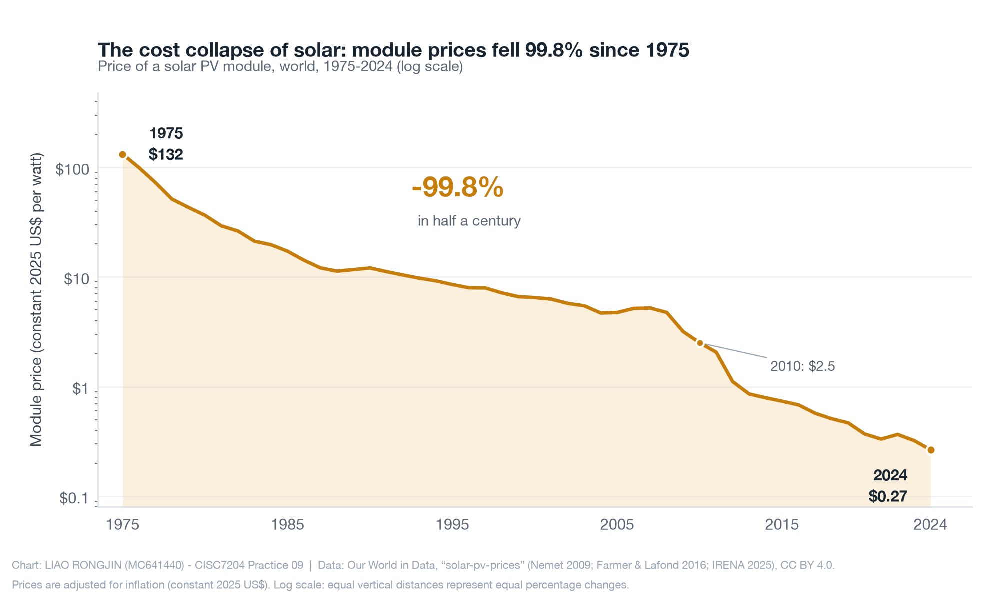

# Liao Rongjin — Data Science Portfolio

I am a data science student at the University of Macau, working at the intersection of statistics, programming, and clear visual communication. I turn public datasets into honest, readable analyses: reproducible code, documented data sources, and visuals that answer a specific question instead of decorating a slide.

## Technical skills

- **Languages and tools:** Python (pandas, Matplotlib, scikit-learn), Jupyter, Git and GitHub
- **Data work:** data cleaning, exploratory analysis, descriptive statistics, regression and model evaluation
- **Communication:** static data visualization, chart design, technical writing
- **Foundations:** probability and statistics, linear models, machine learning concepts

## Project showcase

### Solar PV: a half-century cost collapse and the global capacity boom

**Research question:** How much have solar photovoltaic (PV) module costs fallen since 1975, and how has global installed solar capacity grown in response?

**What the findings show:** A solar PV module cost about **$132 per watt in 1975** and about **$0.27 per watt in 2024** — a **99.8% decline** in inflation-adjusted terms. That cost collapse built a deployment boom: global cumulative installed capacity grew from **1.2 GW in 2000** to **1,883 GW (≈1.9 terawatts) by the end of 2024**, passing the 1-terawatt mark in 2022. The figure above uses a logarithmic scale so that equal visual steps represent equal percentage changes; a second figure in the repository shows the accelerating growth in installed capacity.

- **Repository:** [data-science-project](https://github.com/Erik0380/data-science-project)
- **Status:** Completed
- **Data and tools:** public data from Our World in Data (CC BY 4.0), analysed in Python with pandas and Matplotlib. Full data sources, methods, findings, and limitations are documented in the repository README.

## Contact

- GitHub: [@Erik0380](https://github.com/Erik0380)
